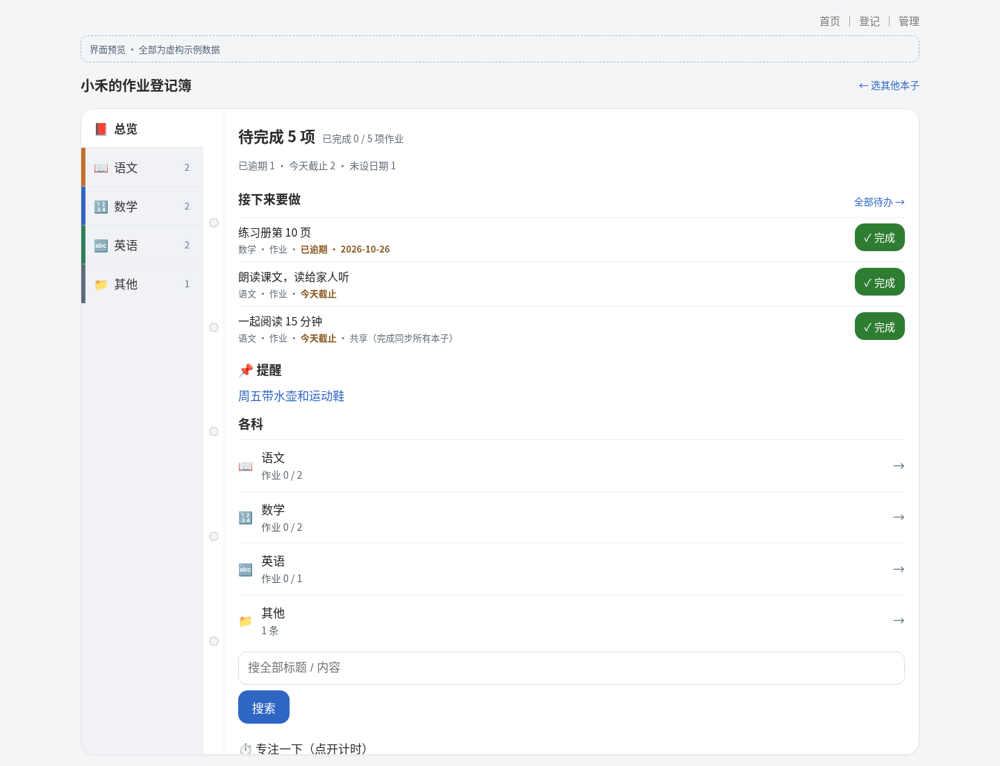
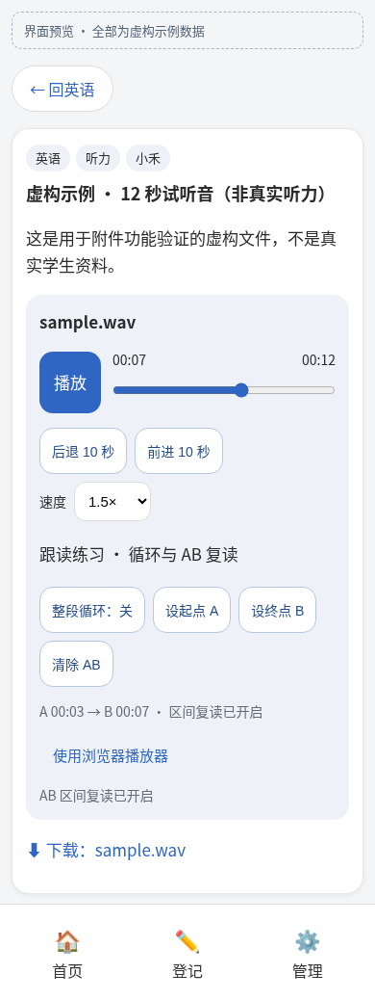
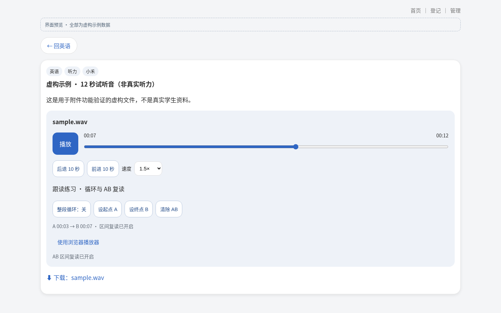
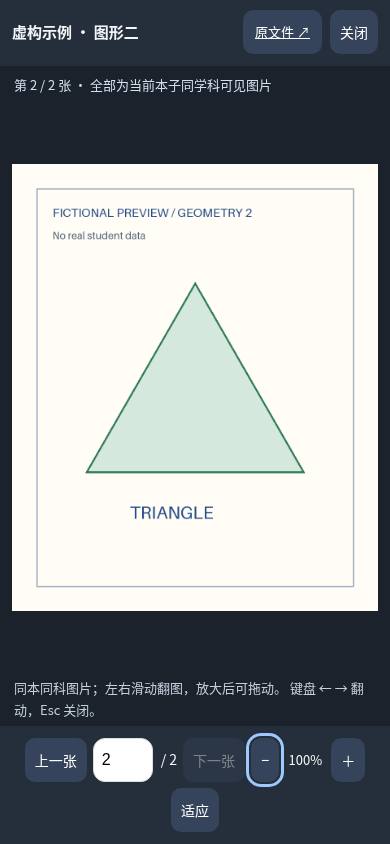
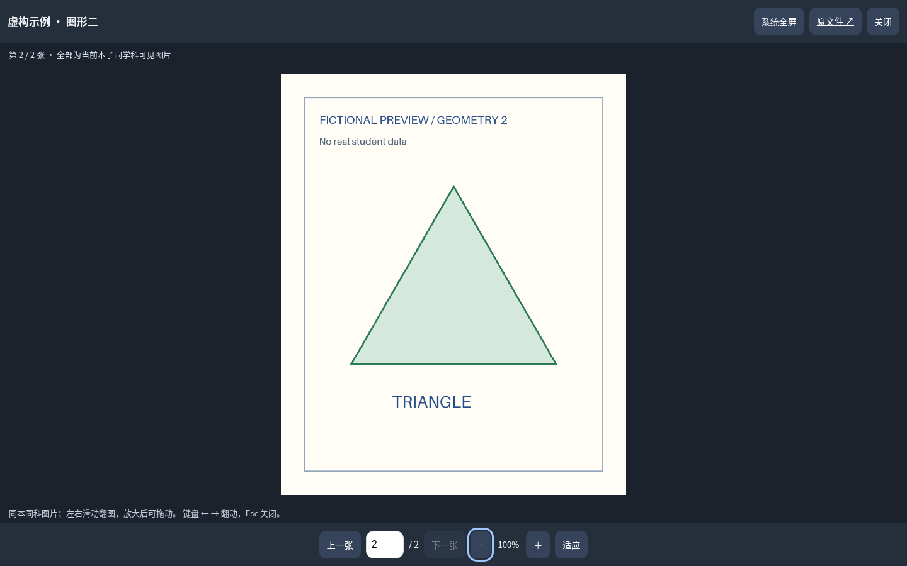
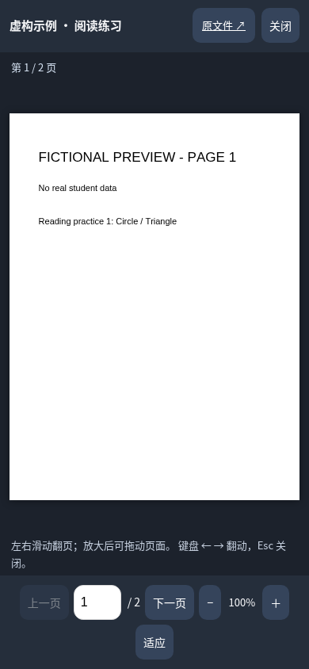
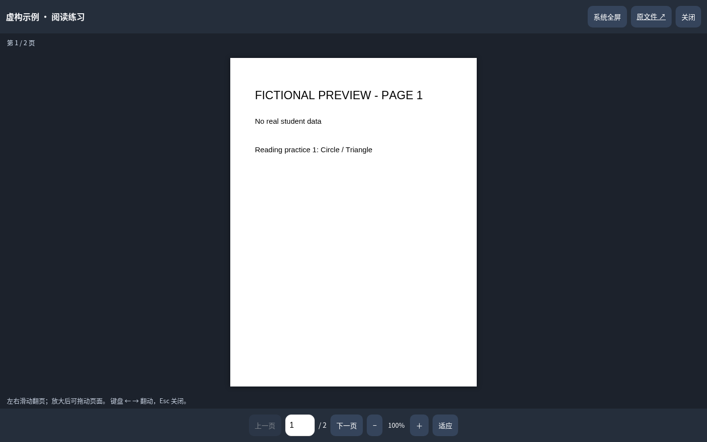

# 界面改动预览

登记页后续已增加语音及全录入方式的孩子上下文，并取消新建共享内容；最新运行截图与验证见 [语音登记预览](voice-entry.md)。下文登记截图保留为上一版改动记录。

保留原来的活页夹、柔和配色和标准库运行方式，重点减少“先翻进去才知道有什么”和“登记后不知道成功了哪些”的成本。下列为本分支实际运行的 Chromium 截图；所有名字、作业均为虚构，截图上有预览提示，不是真实部署。

## 多孩首页：每本先告诉你下一步


原封面的计数只包含孩子专属内容，打开本子后却会看到共享内容，统计口径不一致。现在封面与本内一致：统计自己的和共享的可见内容，不统计尚未公开的内容；突出待完成、逾期、今天截止和下一项，而非只给一个总完成分数。颜色固定跟随孩子 ID，重命名或其他孩子被删除后不会跳色。


手机一列，每本保留姓名与书脊颜色；“打开本子”和“给某某登记”是独立入口，后者预选手动表单里的孩子。移除延时拦截，原生链接支持键盘、新标签打开；不是强制把多个孩子任务混成一个总列表。未添加头像、积分、排名或自动重排，避免引入额外家庭资料与比较压力。

## 本子总览：先看任务，再翻学科



总览显示全部待完成数，不再用“今天进度已满”掩盖逾期作业；最多三项按截止日期排序，未设日期排最后。其余从“全部待办”进入，完成状态仍可撤销。学科整行可点，当前本子与切换入口清楚，未到显示时间的内容仍不泄露。


手机只保留底部主导航，顶部学科继续横滑，当前学科自动滚入视野。共享作业在列表和详情明确说明完成会同步所有本子；本次没有改变这一原有语义、迁移数据或实现每个孩子独立完成。

## 登记：默认手动，识别后核对


手动与文字／拍照识别为并列入口，默认手动，不必先越过一大段 AI 操作。标签常显，原链接、定时显示、置顶折叠在更多选项内；保留附件、截止日期、类型、正文及原有能力。未配置模型提前提示并保留 JSON 草稿路径，外部模型的数据发送与费用也有说明。快捷登记只预选手动表单，AI 草稿仍需逐条确认孩子，避免猜测归属。

批量创建只删除成功草稿；失败项显示原因，未勾选项保持原样。连接中断导致结果不明时保留草稿并阻止盲目再次提交，先检查本子以免重复创建。

## 附件：听力与全屏阅读



大号播放与进度条是主操作；±10 秒和倍速紧随其后。整段循环与 AB 复读放在可展开跟读区域，避免首屏塞满低频按钮。原生播放器是无 JavaScript 时的默认显示，也能随时切换回来；音频错误有提示和下载原文件。HTTP Range 让媒体可以按段加载和拖动，不再整文件读进服务端内存。





图片详情点开为全屏对话框，可在当前孩子本子同学科可见图片间翻动；不是所有孩子附件混在一起，也不改“每条内容一个附件”的存储结构。上下张、序号跳转、缩放／适应、左右键／滑动、Esc／关闭可用，关闭返回原焦点。放大后通过滚动／触摸平移查看。





PDF 使用本地 PDF.js 6.4.299 逐页渲染，而非只依赖手机不一致的内嵌 PDF 插件。页码跳转、上一页／下一页、缩放、适应、键盘与滑动均在同一全屏窗口里。桌面支持浏览器提供的系统全屏；手机用占满视口的阅读窗口。关闭始终可用，原文件链接保留。



PDF.js 的模块、worker 与 Apache-2.0 许可证随仓库提供，不依赖 CDN，不增加 Python 包。它增加约 3 MB 静态资源，部署不能再只复制 app.py；Dockerfile 已包含静态目录。没有附加 CMaps／字体资源包、OCR、批注、文字选择或 PDF 密码输入；复杂／加密文件失败会给原文件回退。需随上游安全版本维护此客户端依赖。页面栅格限制为最长边 4096 像素，较高放大倍数可能较模糊。

## 接口边界与验证

- 环境令牌或管理页令牌已配置时，`GET /api/items` 也要求有效令牌，和写入、学科／孩子列表保持一致。未配置时仍兼容可信局域网。此处是 PR #1 时的状态；当前网页登录与全站 HTTPS 反代要求见 [登录与 HTTPS 部署说明](login.md)。
- 没有数据库结构迁移，不改共享完成语义、删除孩子后的转共享行为，无 Python 第三方运行依赖，不做生产部署或自动合并。PDF 阅读器增加了内置客户端 PDF.js，见下文。
- 标准库 HTTP／数据库回归覆盖封面统计、到期排序、空／单／多孩、可见时间、搜索上下文、共享完成、手动登记、中文附件、API 令牌与部分成功返回。
- 可选 Playwright 回归覆盖桌面及 320／390px 页面无水平溢出、登记模式与孩子预选、真实部分创建失败与修正重试、未勾选保留、连接断开时保留草稿。实际手机、外部模型、真实公网代理没有验证。
- 附件浏览器回归使用真实的两页 PDF、两张图片与 12 秒 WAV 虚构素材，在 Chromium 桌面、390px 与 320px 视口验证翻页／翻图、跳转、缩放、关闭／焦点恢复、合成触屏滑动，以及真实音频播放、拖动、倍速、循环状态和 AB 区间。还验证了加载失败与关闭 JavaScript 时的回退，没有宣称 iOS Safari 真机通过。

## 本机交互预览

```bash
python3 tools/preview.py
# http://127.0.0.1:8766/
```

预览只绑定本机，使用临时数据库，不读取仓库 `data/`；退出会清掉虚构数据。它是本地演示，不是持续在线的公网预览或生产部署。
