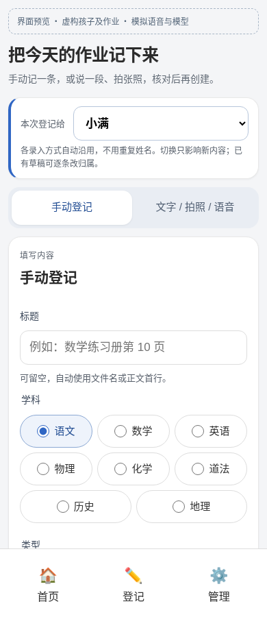
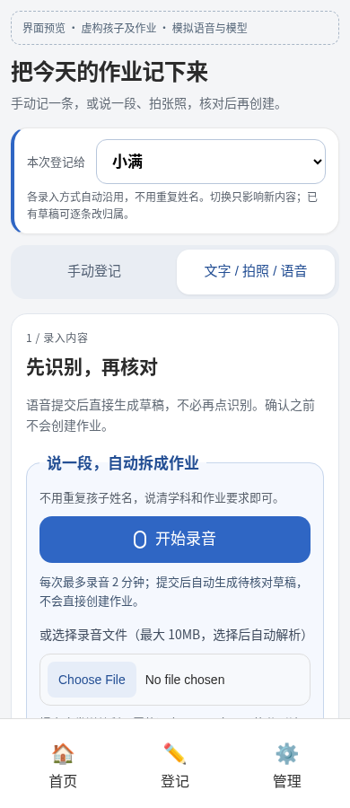
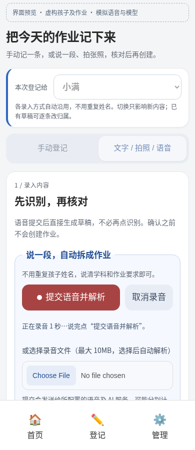
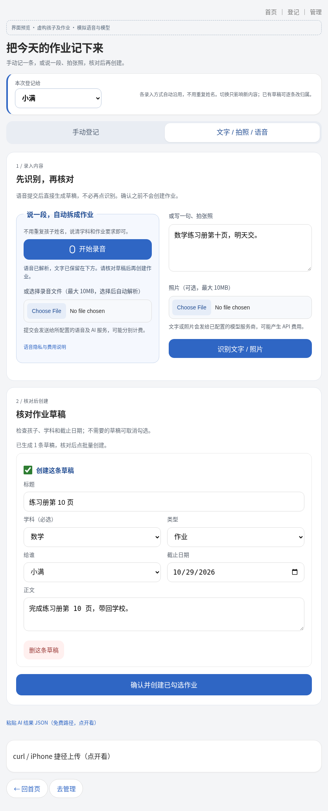

# 按孩子登记与语音录入预览

这些是本分支实际运行的 Chromium 页面，使用隔离数据库、虚构孩子与作业。麦克风使用浏览器合成音轨，语音转写与 AI 模型均为本地桩服务；不是实际孩子资料，也不是第三方识别准确率测试。

## 手机：沿用孩子，减少重复选择

从孩子本子或“给某某登记”进入后，手动、文字、照片、录音均沿用该孩子。顶部可改孩子，已有草稿不随切换偷偷改变；核对草稿时可逐条修改归属。全局登记入口在多孩时先选孩子，单孩直接进入，没有孩子时提示先添加。

手动表单保留所有原字段，常用项在前、低频选项折叠；手机单列，平板双列。输入与主要按钮至少 44px，输入文字时检测可视视口缩小并收起底栏，降低键盘遮挡；这只是模拟视口验证，不代替真实设备键盘测试。

## 手机：录音提交后直接到草稿

开始、提交、取消及录音时长明确分开。提交后先语音转写、再 AI 拆分，自动进入核对，不必再点识别，也不直接创建。录音期间锁住孩子和冲突操作，取消不发送音频；两分钟到时只停止录音，仍由用户决定是否提交。

语音需安全上下文、浏览器麦克风权限及服务端 STT + LLM 配置。不能录音时保留音频文件上传、文字、照片与手动路径。文件选择后自动解析，原始录音不写入服务器文件或作业附件。两家服务可能分别计费，说明在页面和 README；没有真实付费请求。

## 平板：录入与核对有层次

平板将录音与文字 / 照片并排，核对区在下方；草稿显示标题、学科、类型、孩子、日期与正文，最后统一确认创建。转写文字保留在输入框中，AI 解析失败后可以只重试文字解析。

## 历史数据与验证边界

- 不再提供新建共享内容。网页表单、HTTP 创建接口、AI 批量接口均要求有效孩子；旧捷径需要补上具体 `child_id`，`/api/lists` 不再返回 `0` 选项。
- 数据库结构不变。历史 `child_id=0` 不删除、不隐藏、不猜测归属，仍在各本可见并继续共用完成状态。删除孩子后的原有转共享行为也未改，迁移需单独决定。
- 23 项标准库测试通过；隔离浏览器测试覆盖 320 / 390 / 834 / 1280px、真实 MediaRecorder + 合成麦克风输入、STT→LLM HTTP 流程、归属覆盖与修正、文字/照片上下文、取消、权限拒绝、无 MediaRecorder 回退、上传自动解析和键盘视口模拟。没有页面脚本错误。
- 原有登记浏览器回归也通过，覆盖部分失败、未勾选草稿与创建结果不明时保留草稿。真实 iPhone / iPad / Safari 麦克风、真实触摸键盘与付费转写没有验证。

复现：`uv run --no-project --with playwright==1.55.0 tests/browser_voice.py`，需要 Chromium。该脚本自行启停隔离服务并输出截图到 `/tmp/school-board-voice-previews`，不读取真实 `data/`。
